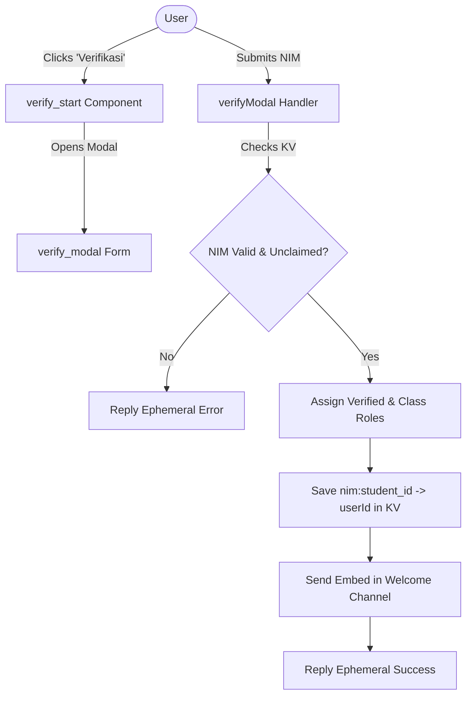

# Verkomp Bot 🤖

A serverless Discord bot built for student cohort verification and community server management. Powered by **Cloudflare Workers** and **Hono**, Verkomp Bot handles Discord interactions purely over HTTP webhooks—no persistent WebSocket gateway or dedicated servers required.

Originally created for the **ILKOMERrZZ'63** (Computer Science Cohort '63) Discord community.

---

## ✨ Features

- **Automated NIM / Student Verification**:
  - Modal form popup (`verify_modal`) triggered by a single button click.
  - Matches student identification numbers (NIM) against a roster CSV stored in Cloudflare KV.
  - Prevents duplicate claims: binds 1 NIM to 1 Discord account (`nim:<student_id>`).
  - Auto-assigns both the **Verified Role** and their respective **Class Role** (e.g., `SS12`, `SS13`, etc.).
  - Sends a rich welcome announcement to the designated welcome channel.
- **Self-Assignable Roles Picker**:
  - Interactive multi-select dropdown menu configured via `ROLES` in `wrangler.jsonc`.
  - Allows members to add or remove hobby/game roles (e.g., *Valorant*, *Roblox*, *Minecraft*, *ambis mode on aktif*) with custom server emoji support.
  - Ephemeral status feedback showing exactly which roles were added or removed.
- **Server Rules Broadcaster**:
  - Formatted rules component posted directly by the bot using modern Discord message layouts.
- **Admin Audit Endpoint**:
  - Protected HTTP endpoint (`GET /yang-belum-masuk?key=<ADMIN_SECRET>`) that lists all students from the roster who have not yet verified, grouped and sorted by class.
- **Edge Performance & Security**:
  - Built with Hono on Cloudflare Workers.
  - Cryptographic Ed25519 request signature verification (`discord-interactions`).
  - Ephemeral interaction responses to keep channels clean and protect user privacy.

---

## 🏗️ Tech Stack

- **Runtime**: [Cloudflare Workers](https://workers.cloudflare.com/)
- **Framework**: [Hono](https://hono.dev/)
- **Database / Cache**: [Cloudflare Workers KV](https://developers.cloudflare.com/kv/)
- **Discord API**: `discord-api-types/v10`, `discord-interactions`
- **Language**: TypeScript (`tsx`, `wrangler`)
- **Package Manager**: [pnpm](https://pnpm.io/)

---

## 📁 Project Structure

```text
verkomp-bot/
├── data/
│   ├── students.example.csv   # Sample student roster CSV
│   └── students.csv           # Production student roster (gitignored)
├── scripts/
│   └── register-commands.ts   # Script to register slash commands to Discord
├── src/
│   ├── commands/              # Slash commands definitions and handlers
│   │   ├── index.ts           # Command exports & registration mapping
│   │   ├── setup-role.ts      # /setup-role handler
│   │   ├── setup-rules.ts     # /setup-rules handler
│   │   └── setup-verification.ts # /setup-verification handler
│   ├── components/            # Message component interaction handlers
│   │   ├── index.ts
│   │   ├── role-select.ts     # Select menu for self-assignable roles
│   │   └── verify-start.ts    # Button that opens the verification modal
│   ├── modals/                # Modal submit handlers
│   │   ├── index.ts
│   │   └── verify-modal.ts    # Handles NIM verification submission
│   ├── lib/                   # Utility helpers and business logic
│   │   ├── students.ts        # CSV parsing and KV student cache loader
│   │   ├── utils.ts           # Ephemeral reply & modal value helpers
│   │   └── verify.ts          # Core verification & Discord role grant logic
│   ├── discord.ts             # Discord REST API client helper & Env typing
│   └── index.ts               # Hono app entry point (HTTP routes & webhook router)
├── .dev.vars.example          # Environment variable template for local dev
├── wrangler.jsonc             # Cloudflare Workers configuration & static vars
├── package.json
└── tsconfig.json
```

---

## ⚙️ Configuration

### 1. Cloudflare Workers Configuration (`wrangler.jsonc`)

The following variables and bindings are set in `wrangler.jsonc`:

```jsonc
"vars": {
  "VERIFIED_ROLE_ID": "1565338762295382078",
  "WELCOME_CHANNEL_ID": "1565362155686207550",
  "CLASS_ROLES": {
    "SS12": "1565348003609321522",
    "SS13": "1565348140389896353"
    // ... other classes
  },
  "ROLES": {
    "VALORANT": {
      "emoji": "1566662110086176840",
      "id": "1566485304662032554"
    }
    // ... other roles
  }
},
"kv_namespaces": [
  {
    "binding": "VERIFIED",
    "id": "<your-kv-namespace-id>"
  }
]
```

- `VERIFIED_ROLE_ID`: Role ID assigned to all successfully verified members.
- `WELCOME_CHANNEL_ID`: Channel ID where welcome cards are sent upon successful verification.
- `CLASS_ROLES`: Map of class codes to Discord Role IDs.
- `ROLES`: Map of self-assignable roles with custom emoji IDs and Discord Role IDs.
- `VERIFIED`: Workers KV namespace binding used for storing student records and user mappings.

### 2. Environment Variables & Secrets

Create a `.dev.vars` file for local development (copy from `.dev.vars.example`):

```bash
cp .dev.vars.example .dev.vars
```

| Variable | Description | Where to Find |
|---|---|---|
| `DISCORD_APP_ID` | Discord Application ID | Discord Developer Portal -> General Information |
| `DISCORD_PUBLIC_KEY` | Public key used for verifying webhook signatures | Discord Developer Portal -> General Information |
| `DISCORD_BOT_TOKEN` | Bot user token with necessary permissions | Discord Developer Portal -> Bot |
| `DISCORD_GUILD_ID` | Guild (Server) ID for registering guild commands | Discord App (Enable Developer Mode -> Right-click Server -> Copy ID) |
| `ADMIN_SECRET` | Secret token to authenticate the audit endpoint | Custom secure string generated by you |

In production, set these secrets on Cloudflare Workers using Wrangler:

```bash
wrangler secret put DISCORD_APP_ID
wrangler secret put DISCORD_PUBLIC_KEY
wrangler secret put DISCORD_BOT_TOKEN
wrangler secret put DISCORD_GUILD_ID
wrangler secret put ADMIN_SECRET
```

---

## 👥 Student Data Preparation & Seeding

The bot matches member verification attempts against student data stored in Cloudflare KV under the key **`data:students`**.

### CSV Format

The file must have the header `student_id,name,class` (comma or semicolon delimited):

```csv
student_id,name,class
2301001,Budi Santoso,SS12
2301002,Siti Aminah,SS12
2301003,"Andi Pratama, S.Kom",SS13
```

### Seeding to Workers KV

Upload your CSV file directly to your Cloudflare KV namespace using Wrangler:

```bash
# For local development:
wrangler kv key put --binding=VERIFIED "data:students" --path=./data/students.csv --local

# For production:
wrangler kv key put --binding=VERIFIED "data:students" --path=./data/students.csv
```

---

## 🚀 Getting Started

### 1. Install Dependencies

Ensure you have [pnpm](https://pnpm.io/) installed:

```bash
pnpm install
```

### 2. Register Slash Commands

Register the slash commands (`/setup-verification`, `/setup-role`, `/setup-rules`) to your Discord server:

```bash
pnpm run register
```

### 3. Run Locally

Start the Wrangler development server:

```bash
pnpm run dev
```

To test Discord interactions locally, expose your local port (default: `8787`) to the internet using a tunnel such as [Cloudflare Tunnel](https://developers.cloudflare.com/cloudflare-one/connections/connect-networks/) or [ngrok](https://ngrok.com/):

```bash
ngrok http 8787
```

Copy the HTTPS forwarding URL (e.g. `https://xxxx.ngrok-free.app`) and set it as your **Interactions Endpoint URL** in the Discord Developer Portal under your application's **General Information** page.

### 4. Deploy to Cloudflare Workers

Deploy the worker to Cloudflare's global edge network:

```bash
pnpm run deploy
```

Once deployed, update the **Interactions Endpoint URL** in the Discord Developer Portal to your Cloudflare Worker URL:

```text
https://verkomp-bot.<your-subdomain>.workers.dev
```

---

## 🎮 Slash Commands & Endpoints

### Discord Slash Commands

> [!NOTE]
> All setup commands require **Administrator** permissions (`default_member_permissions: "8"`).

| Command | Description |
|---|---|
| `/setup-verification` | Posts the verification panel with the "Verifikasi" button in the current channel. |
| `/setup-role` | Posts the self-assignable roles dropdown menu in the current channel. |
| `/setup-rules` | Posts the server rules announcement in the current channel. |

### Bot Interaction Flow



### HTTP Endpoints

| Method | Path | Description | Authentication |
|---|---|---|---|
| `GET` | `/` | Health check endpoint, returns `"Verkomp Bot Active"`. | None |
| `POST` | `/` | Discord Interactions webhook handler. | Discord Ed25519 Signature |
| `GET` | `/yang-belum-masuk?key=<ADMIN_SECRET>` | Returns plain-text list of unverified students sorted by class. | `ADMIN_SECRET` query param |

---

## 🛠️ Bot Permissions Required

Ensure the bot has the following permissions and role hierarchy in your Discord server:

1. **Manage Roles (`MANAGE_ROLES`)**: To grant verified and class roles to members.
   - ⚠️ **Important**: The bot's role must be positioned **higher** in the server role list than any roles it manages (`VERIFIED_ROLE_ID`, `CLASS_ROLES`, and `ROLES`).
2. **Send Messages (`SEND_MESSAGES`) & Embed Links (`EMBED_LINKS`)**: To send welcome cards and setup messages.
3. **Use Slash Commands**: Required for users to interact with the bot.

---

## 📜 Available Scripts

- `pnpm run dev`: Starts local Wrangler development server.
- `pnpm run deploy`: Builds and minifies Worker, then deploys to Cloudflare.
- `pnpm run register`: Registers slash commands with the Discord Guild API.
- `pnpm run cf-typegen`: Generates and synchronizes TypeScript types for Cloudflare bindings.

---

## 📄 License

This project is open-source and available under the [MIT License](LICENSE).
